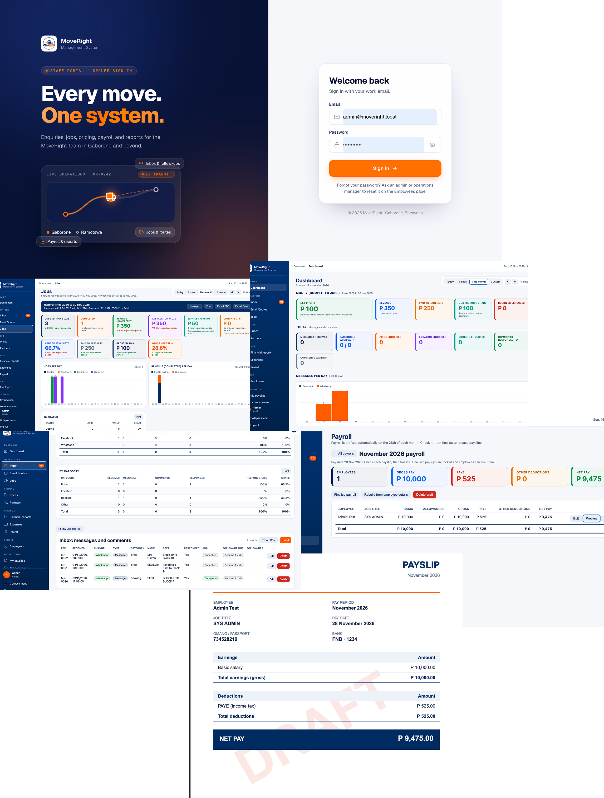

# MoveRight Management System

Simple MERN app: MongoDB + Express (server) and React (client).

**Live:** [moveright-backend-v1.onrender.com](https://moveright-backend-v1.onrender.com)

<p align="center">
  
</p>

## Run it (development)

You need Node 18+ and MongoDB running locally (or a MongoDB Atlas link).

```bash
# 1. Server
cd server
npm install
cp .env.example .env      # then edit .env (JWT_SECRET, admin email/password, MONGO_URI, and the Email Quotes settings)
npm run dev               # http://localhost:5000

# 2. Client (new terminal)
cd client
npm install
npm run dev               # http://localhost:5173
```

Log in with the ADMIN_EMAIL / ADMIN_PASSWORD from `.env`. That first admin is created automatically.

## Run it (production, one server)

```bash
cd client && npm install && npm run build     # creates client/dist
cd ../server && npm start                      # serves the API and the built app together
```

## Who sees what

Everyone who uses the system is an employee with a login. Their **role** (set on the Employees page) decides what they can open:

| Role | Area | What they see |
|------|------|---------------|
| admin, operations manager | `/admin` | Everything: Dashboard with money, Inbox, Email Quotes, Jobs (with partner costs), Prices, Partners, Financial reports, Expenses, Payroll, Employees, plus their own payslips and documents |
| sales and marketing, customer support | `/users` | Dashboard (messages only), Inbox, Email Quotes, Jobs (no partner costs), plus their own payslips and documents |
| driver, cleaner | `/users` | Dashboard (messages only), Inbox, Jobs (no partner costs), plus their own payslips and documents |

- Only an admin can give, change or remove the admin role, or edit an admin's record. Nobody can change their own role or delete themselves.
- Role changes and removals take effect on the next request, even for someone already logged in.
- When upgrading from the old setup, the server moves old logins over on start-up: staff → customer support, payslips-only → driver. Every login without an employee record gets one with salary 0. The changes are listed in the server log, so check roles on the Employees page afterwards.

## Modules

- **Prices**: services and locations, each with a price. Add, update, delete (admin only; staff can read).
  We have no trucks, so each location has a partner (picked from Partners), the partner price and our markup in Pula.
  Client price (full) = partner price + our markup, worked out automatically on add and edit. Staff only see the client price.
- **Partners**: name, phone and the service they provide. Partner prices and our markup are set per location under Prices.
- **Jobs**: Inbox ref (search and pick the enquiry; fills in customer, source and WhatsApp number), customer, route (fills the route price, partner and partner price), extra services with quantity, total price = route price + services, date, status and source (colour coded). Search jobs by ref, phone or customer across all dates. "Our share" = price charged minus partner cost.
- **Expenses**: business costs by category (colour coded), with an optional receipt (PDF or photo, up to 5 MB, stored in MongoDB).
- **Inbox**: every Facebook/WhatsApp message and comment gets an automatic ref (MR-0001, MR-0002 …) that can't be edited, and shows whether it became a job. Each item has a category (price / location / booking / other) and a Responded flag.
  **Follow-ups**: an answered enquiry that isn't a job yet is due for a follow-up 2 days after it came in, then 2 days after each follow-up, until it becomes a job or is marked "Not interested". **Record follow-up** saves the date, outcome (no answer / still interested / not interested), a note and who did it. **Follow-ups due** lists everything overdue or due today from any date.
- **Email Quotes**: quote requests from the website's Get a Quote form. Each gets a ref from the same sequence as the Inbox (MR-0042), so refs never clash.
  When a request arrives, the customer gets a confirmation email and the support inbox gets a notification. **Reply by email** shows the move details and the whole conversation, then sends your reply from the support Gmail (it also appears in Gmail's Sent folder). Customer replies are read from the support Gmail every couple of minutes and added to the conversation; the status becomes "Customer replied". The number next to Email Quotes counts new requests and customer replies waiting.
  Sending problems are shown in red on the quote. Managers can delete quotes; nobody can add or edit them (they only come from the website). See **Email Quotes setup** below.
- **Dashboard**: messages today, price/location enquiries today, comments responded to today, 14-day chart, enquiry-to-job rate, revenue, partner payments, markup, expenses and net profit.
  Net profit = revenue from completed jobs − partner payments − expenses.

### Date selector and reports (every module)

- Each module has a **Date** bar (Today, Yesterday, Last 7 days, This month, Last month, This year, All time, or any custom range, with ◀ ▶ to step back and forward). The choice carries across modules for the browser tab.
- **Inbox, Jobs, Expenses**: the list shows only records in the chosen dates, and **+ Add** pre-fills the chosen day (e.g. pick Yesterday to enter yesterday's messages). Inbox items now have an editable Received date/time.
- **Prices, Partners, Employees**: the lists always show everything; the date only changes the report.
- Every module shows a report: headline figures compared with the previous period of the same length, charts per day (per month for long periods) and breakdown tables with totals. **Print / PDF** prints the report; **Export CSV** downloads the list.
- The team activity report (on Employees) shows who entered what. This tracking starts with this version, so older records show as "Automatic or not tracked".

## Email Quotes setup

1. Turn on 2-Step Verification for moveright.support@gmail.com, then create an **App password** (Google Account → Security → App passwords). Put it in `server/.env` as `SMTP_PASS` (spaces don't matter). IMAP must be on (Gmail settings → Forwarding and POP/IMAP; it usually is).
2. Set `WEBSITE_API_KEY` in `server/.env` to a long random string (`openssl rand -hex 32`) and put the **same** value in the website's `.env.local` (`trucking-app/apps/customer-web`), with `QUOTES_API_URL` set to this server's address.
3. Restart the server. The log says if email is not set up; quotes are still saved without it, and the problem is shown on each quote.

How it fits together: the website's form posts to its own `/api/quote`, which forwards to `POST /api/public/quotes` here with the shared key. That endpoint needs no login but rejects anything without the key, so only the website can create quotes.
Gmail allows about 500 emails a day from one account. Replies sent straight from Gmail (rather than from this system) reach the customer but are not added to the conversation here.

## Connecting Facebook and WhatsApp (optional, do later)

The Inbox works without this: staff can add messages by hand with **+ Add**.
To fill it automatically, create a Meta app (developers.facebook.com) with Messenger and WhatsApp Cloud API, then:

1. Put your server on a public HTTPS address.
2. In Meta's webhook settings, set the callback URL to `https://YOUR-DOMAIN/webhook/meta` and the verify token to `META_VERIFY_TOKEN` from `.env`.
3. Page webhook: subscribe to `messages` and `feed`. WhatsApp webhook: subscribe to `messages`.
4. Put your App Secret in `META_APP_SECRET` (requests are then signature-checked) and your Facebook Page ID in `FB_PAGE_ID`.

How it behaves:
- Messages are categorised by keywords (price words, your location names, booking words). Staff can correct the category.
- Facebook: when you reply in Messenger or to a comment, the item is marked Responded automatically.
- WhatsApp: Meta does not send your replies to the webhook, so click **Mark responded** in the Inbox.
- Meta needs app review and a business account before live use. Expect some setup time.

## Employees, payroll and payslips

- **Employees**: name, surname, email (their login), role, password, job title, basic monthly salary (0 = not on payroll), bank details and recurring deductions (e.g. pension). **Documents** stores CVs, certificates, IDs and contracts (PDF or photo, up to 5 MB each, kept in MongoDB).
- **Payroll**: on the 28th of each month (Gaborone time) the server drafts that month's payroll: one payslip per active employee who has started. The server checks when it starts and every hour, so it catches up after sleeping. An admin can edit payslips (allowances, deductions, PAYE override), rebuild, or delete the draft, then **Finalise**. Finalised payroll is locked. **Run payroll** drafts any other month by hand.
- **PAYE** is worked out from the Botswana resident annual bands in `server/payroll.js` (`PAYE_BANDS`). Check them against BURS each tax year and update that table if they change.
- **Payslips** are PDFs with the logo, employee details, earnings, deductions and net pay (Preview or Download). Employees see their own once payroll is finalised.

## Financial reports and exports

**Financial reports** shows an income statement (revenue, partner payments, gross profit, expenses by category, payroll, net profit), each line as % of revenue and against the previous period. It also has key ratios (margins, cost ratios, average job value, break-even jobs, cancellations, pipeline), a 12-month trend, and breakdowns by source, route, partner, expense category and employee.
Every module report has **Export PDF** (branded statement) and **Export Excel** (one sheet per table, real numbers with formats). A whole month is compared with the month before; other ranges with the same number of days before.

Optional settings for PDFs (server `.env`): `COMPANY_NAME` (default MoveRight) and `COMPANY_ADDRESS` (default Gaborone, Botswana). PDFs use the small logo in `server/assets/logo.png`.

## Not included yet (good next steps)

Turning an email quote into a job in one click, invoices, payment tracking, job calendar, password reset, WhatsApp auto-replies, emailing payslips.
